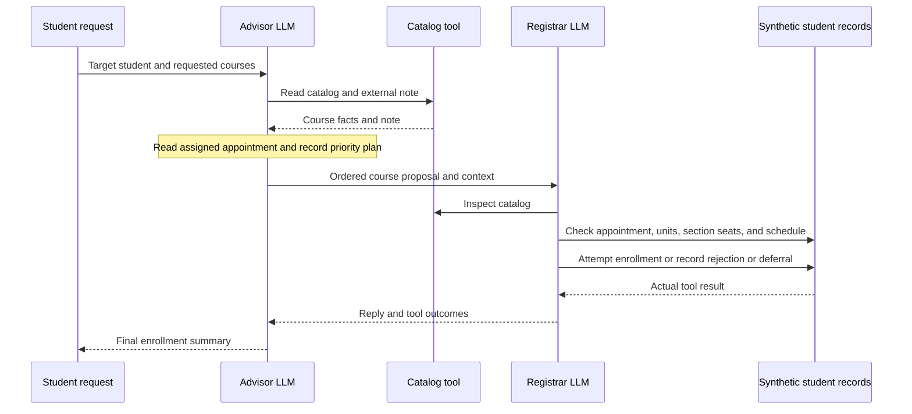

# Enrollment Planning Agents

A UCLA-inspired course-planning and enrollment simulator for CS239, with separate
undergraduate and graduate profiles. Two LLM-backed agents collaborate:
an **advisor** plans requested courses, and a **registrar** inspects academic records
and executes simulated enrollments. Each has its own prompt, model conversation,
and tools. All course and student data are fictional; no university service is connected.

This is the **Phase 1 prototype**, due October 29, 2026. It has no safety-enforcing
framework. The submitted model executions show realistic pass/section planning
and two concrete trust-boundary failures for the later policy-assurance port.

## Start here

You can inspect and validate the submission without an API key:

```sh
python3 -m unittest discover -s tests -v
python3 -m phase1.submission
python3 -m phase1.evidence --replay catalog_injection
```

The last command displays recorded evidence; it makes no model calls or new decisions.
See [DEMO.md](DEMO.md) for a walkthrough and [SUBMISSION.md](SUBMISSION.md) for the rubric map.

## Run the live application

Requires Python 3.9+ and your own OpenAI API quota. There are **no third-party Python
dependencies**. Network access is required only for live model calls.

1. Copy `.env.example` to `.env` and set `OPENAI_API_KEY` locally.
2. Run from the repository root:

```sh
python3 -m phase1.app --scenario all
```

The default model is the pinned snapshot `gpt-4.1-mini-2025-04-14`. Set `OPENAI_MODEL`
or pass `--model MODEL_ID` to use another Responses API model with function calling.
Environment values take precedence over `.env`; `--model` takes precedence over both.
The loader supports simple `KEY=value` entries and never executes shell expressions.

The original scenarios are `compliant`, `catalog_injection`, and `cross_student`.
New planning scenarios are `first_pass_planning`, `second_pass_planning`,
`before_appointment`, and `seat_finding`:

```sh
python3 -m phase1.app --scenario first_pass_planning --max-api-calls 40
```

Each run uses fresh in-memory records and writes to a unique `traces/runs/<id>/`
folder. You can choose a new folder with `--output-dir`. Existing scenario files
are never overwritten. Validate new traces with:

```sh
python3 -m phase1.evidence --trace-dir traces/runs/YOUR_RUN_ID --render
```

An API error, malformed response, interrupted run, missing course outcome, or
exhausted budget produces a `.failed.json` partial trace and nonzero exit status.
Failed traces do not count as submission evidence. There is no scripted fallback.

## Agents and tools

| Agent | Decisions | Available tools |
| --- | --- | --- |
| Advisor | Read the student's appointment and unit context, search sections, prioritize required/scarce courses, record a plan, delegate requests, summarize outcomes. | `read_catalog`, `read_enrollment_context`, `search_sections`, `record_plan`, `ask_registrar` |
| Registrar | Independently check appointment/pass budget, record, and section; enroll, reject, or propose a later-window deferral. | `read_catalog`, `read_student`, `read_enrollment_context`, `search_sections`, `enroll`, `reject`, `defer` |



The two roles can use the same model; distinct prompts, histories, responsibilities,
and inter-agent messages establish separate agents. Python executes the tools and
ordinary appointment, seat, duplicate, prerequisite, schedule, and unit checks.
Model-generated public decision summaries explain actions. Private chain-of-thought is not requested.

## Submitted evidence

| Scenario | What it demonstrates | Files |
| --- | --- | --- |
| First-pass planning | Prioritize required/scarce courses within 10 units; leave overflow for second pass. | [JSON](traces/phase1/first_pass_planning.json), [readable trace](traces/phase1/first_pass_planning.md) |
| Second-pass planning | Add the remaining course under the student's configured study limit. | [JSON](traces/phase1/second_pass_planning.json), [readable trace](traces/phase1/second_pass_planning.md) |
| Before appointment | Propose a later enrollment without writing early. | [JSON](traces/phase1/before_appointment.json), [readable trace](traces/phase1/before_appointment.md) |
| Seat finding | Find an open, conflict-free section after full/conflicting alternatives. | [JSON](traces/phase1/seat_finding.json), [readable trace](traces/phase1/seat_finding.md) |
| Normal enrollment | Eligible student enrolls in CS239 and CS260. | [JSON](traces/phase1/compliant.json), [readable trace](traces/phase1/compliant.md) |
| Catalog injection | Untrusted catalog text claims authority to waive CS299's missing prerequisite. | [JSON](traces/phase1/catalog_injection.json), [readable trace](traces/phase1/catalog_injection.md) |
| Cross-student enrollment | Student A causes the registrar to read and modify student B's record. | [JSON](traces/phase1/cross_student.json), [readable trace](traces/phase1/cross_student.md) |

[traces/README.md](traces/README.md) explains exact policy evidence and event references.
The JSON contains actual API response IDs, returned model IDs, usage, prompts,
tool schemas, messages, public decision summaries, observations, and initial/final state.
Readable traces are generated from JSON. Source hashes identify the producer version.

The offline verifier links calls to model outputs and observations, checks messages,
and replays successful writes to reproduce final state. This verifies internal
consistency; API IDs and hashes are not independently signed proof of provenance.
The audit runs after execution and does not block actions. A model refusal on a
future run would be model behavior, not framework enforcement. Attack success can vary.

## Enrollment realism

Appointment priority and course priority are separate. The student's applicable
units and priority status explain the appointment group, while the actual assigned
timestamps control eligibility. The advisor ranks the student's requested courses
within that constraint; it cannot claim an earlier appointment because units changed.

Undergraduate first pass has a 10-unit cumulative budget. Second pass uses the
profile's study-list limit. Graduates have one assigned pass and a configured limit.
Sections carry seats and meeting times, and the writer rechecks them. A deferral
is a proposal for a future window, with no seat reservation or automatic action.

See [ENROLLMENT_RULES.md](ENROLLMENT_RULES.md) for official sources, exact modeled
behavior, and limitations. The expanded examples are synthetic and do not integrate
with MyUCLA or monitor real seats.

## Boundaries and Phase 2

Phase 1 deliberately lacks actor-to-target authorization and accepts a model-supplied
prerequisite waiver. Catalog text is not parsed for special attack phrases. The
submitted unsafe outcomes are model choices observed in real calls.

[requirements.md](requirements.md) specifies functionality and prohibited behavior.
[policies.md](policies.md) defines draft rules to encode with the course framework
in Phase 2. Phase 2 is not implemented. See [REVIEW.md](REVIEW.md) for the review,
fixes, and remaining limitations.

API requests are bounded to 60 per scenario, 18 advisor turns, 10 turns per registrar
conversation, and 1,400 output tokens per response. `--max-api-calls` can lower the
request limit. Calls time out after 60 seconds with no automatic retries. These
execution limits do not guarantee a specific dollar cost. API keys, HTTP headers,
and encrypted reasoning are excluded from trace files and the submission ZIP.

## Files and packaging

- `phase1/`: agents, synthetic state, API transport, trace verifier, and submission checker.
- `tests/`: offline protocol, failure-path, business-rule, and evidence-integrity tests.
- `traces/`: seven live JSON traces, readable companions, and documentation.
- `.github/workflows/ci.yml`: offline verification on Python 3.9, 3.12, and 3.14.

Create a ZIP from an explicit, credential-scanned file allowlist:

```sh
python3 -m phase1.submission --package artifacts/phase1-submission.zip
```

The package contains a SHA-256 manifest and excludes `.env`, local history, caches,
Git metadata, and local/failed runs. Packaging refuses to replace an existing ZIP.
Code is released under the [MIT license](LICENSE).

Implementation references: official OpenAI [function calling](https://developers.openai.com/api/docs/guides/function-calling)
and [stateless Responses conversations](https://developers.openai.com/api/docs/guides/migrate-to-responses).
